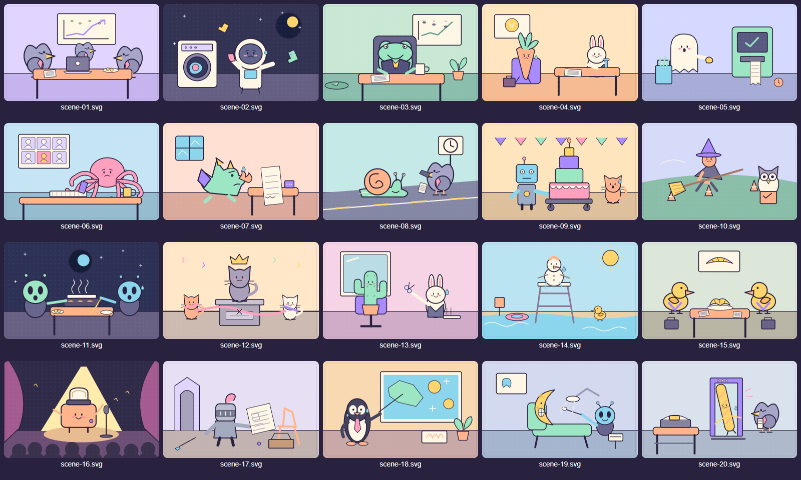

# Bibliothèque EN VRILLE

Ce package contient 410 contenus français originaux, disponibles sans IA, clé ni API externe :

| Jeu | Nombre | Contenu classique disponible |
| --- | ---: | ---: |
| Le Plateau des Mythos | 120 | 100 |
| Vends-moi cette Merde ! | 100 | 100 |
| Tribunal du N’importe Quoi | 60 | 60 |
| Qui parmi nous ? | 110 | 100 |
| Sous-titres Interdits | 20 | 20 |

Les vingt questions Mythos de catégorie `adulte` et les dix questions Qui parmi nous de catégorie `soirée adulte` sont marquées `adult: true`. Elles concernent les soirées et les rencontres ; elles ne contiennent pas de questions sur les traumatismes, la santé ou d’autres informations intimes. Le mode classique les exclut. L’hôte peut désactiver séparément chaque catégorie et passer une question.

## Modifier le contenu

- `src/mythos.ts` : questions, par catégorie, sous forme `[identifiant, question]`.
- `src/products.ts` : produits `[identifiant, nom, description]`.
- `src/court.ts` : accusations `[identifiant, accusation]`.
- `src/who.ts` : questions sur les joueurs `[identifiant, question]`.
- `src/index.ts` : catalogue des scènes, exports et fonction de filtrage.
- `media/scene-01.svg` à `scene-20.svg` : fichiers réellement servis aux joueurs.

Chaque identifiant est explicite et reste stable après modification, déplacement ou suppression d’une autre entrée. Pour ajouter une question, choisir un nouvel identifiant libre du même jeu ; ne pas réutiliser un identifiant supprimé. Dès la première modification administrative, l’API sauvegarde une copie complète de la bibliothèque dans son stockage persistant. Cette copie devient la bibliothèque active et conserve les ajouts, modifications et suppressions après un redémarrage ; les nouvelles entrées d’une future version du package ne sont pas fusionnées automatiquement. `filterContent(options, bibliothèqueActive)` conserve les exclusions de catégories, d’identifiants et de contenu adulte. Une sélection vide reste vide : ne pas contourner les choix de l’hôte en choisissant dans une catégorie désactivée.

Les médias intégrés sont exposés par l’API à `/media/scene-01.svg` etc. En production leur dossier est embarqué dans l’image. Les médias ajoutés depuis l’administration doivent utiliser le volume persistant dédié de l’API.

## Illustrations et crédits

Les vingt scènes ont été dessinées en SVG spécifiquement pour EN VRILLE : conseil de pigeons, astronaute à la laverie, grenouille PDG, carotte en entretien, fantôme au supermarché, poulpe en visioconférence, dragon et facture, contrôle de vitesse d’escargot, robot et gâteau, permis de balai, raclette extraterrestre, monument félin, cactus chez le coiffeur, bonhomme de neige maître-nageur, négociation de canards, grille-pain chanteur, chevalier et meuble en kit, pingouin météo, lune chez le dentiste et baguette à l’aéroport.



Auteur : **Projet EN VRILLE**. Aucune image de film, de série, de jeu vidéo, banque d’images, photographie ou ressource distante n’est utilisée. Les dessins sont faits de formes vectorielles originales. Chaque SVG contient un titre, une description accessible et ses crédits.

Dans toute la mesure permise par le droit applicable, le Projet EN VRILLE renonce aux droits d’auteur et droits voisins sur les textes de cette bibliothèque et ses vingt illustrations originales sous **[CC0 1.0 Universal](https://creativecommons.org/publicdomain/zero/1.0/)**. Ils peuvent être copiés, modifiés, redistribués et utilisés commercialement sans attribution obligatoire. Cette dédicace concerne uniquement les contenus et illustrations de ce package ; elle n’impose aucune licence au code du reste du projet.

La source vectorielle reproductible se trouve dans `scripts/create-media.mjs`. Depuis la racine :

```sh
node packages/content/scripts/create-media.mjs
```

Le script réécrit uniquement les vingt scènes intégrées. Après modification d’une scène, exécuter le script puis vérifier visuellement le fichier résultant.
